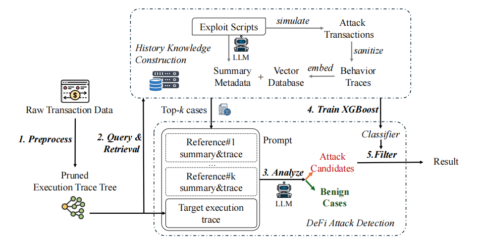

<h1 align="center">🛡️ TxShield：Transaction-level RAG-enabled DeFi Attack Detection</h1>

<p align="center">
  <em>Reasoning over execution behavior with historical attack knowledge</em>
</p>
<p align="center">
  <a href="#overview">Overview</a> ·
  <a href="#architecture">Architecture</a> ·
  <a href="#results">Results</a> ·
  <a href="#quick-start">Quick Start</a> ·
  <a href="#structure">Structure</a> ·
  <a href="#configuration">Configuration</a> ·
  <a href="#paper">Paper</a>
</p>

<p align="center">
  <a href="https://github.com/oumo0/TxShield/issues"></a>
  
  
  
  
</p>

<p align="center">
  <strong>92.93% F1 · 97.87% Precision · 88.46% Recall</strong>
  <br>
  <sub>Kimi-k3 backbone on DeFiAttackBench (728 transactions)</sub>
</p>

---

<a id="overview"></a>

## 🎯 Overview

DeFi attacks vary widely in implementation, yet many reuse a smaller set of behavioral patterns: manipulated prices, abnormal asset flows, reentrant call sequences, unauthorized state changes, and protocol-specific logic abuse. TxShield uses this observation to detect attacks at the **transaction execution trace** level.

Instead of relying only on fixed rules or an LLM's parametric memory, TxShield maintains a historical knowledge base of confirmed attacks. Each case combines an execution trace, an LLM-generated behavioral summary, and structured metadata. For a new transaction, the system retrieves semantically related cases and asks the LLM to reason over behavioral correspondence.

The final decision combines two complementary views:

- **Semantic reasoning:** the LLM interprets call sequences, state-changing behavior, fund movements, and historical analogies.
- **Numerical verification:** XGBoost checks structured trace features, but only after the LLM has identified an Attack candidate.

This ordering is essential: **XGBoost never removes retrieved evidence, contributes to the LLM prompt, or gates LLM inference.**

### Why TxShield?

| Capability         | TxShield                                         | Conventional rule-based detection          |
| ------------------ | ------------------------------------------------ | ------------------------------------------ |
| Analysis target    | Runtime transaction behavior                     | Predefined vulnerability signatures        |
| Knowledge          | 209 historical attacks with behavioral summaries | Static rules and manually encoded patterns |
| Generalization     | Behavioral analogy across protocols              | Strongest on already modeled mechanisms    |
| Reasoning          | RAG or zero-shot, selected dynamically           | Fixed matching or symbolic constraints     |
| Final safeguard    | XGBoost post-filter for Attack candidates        | Tool-specific alert logic                  |
| End-to-end latency | 11.82–15.02 s for highlighted backbones          | Varies by tool and analysis paradigm       |

**Core idea:** TxShield reasons about *attack behavior*, not only vulnerability signatures. It asks: **"Have we seen this behavior before?"**

<a id="architecture"></a>

## 🏗️ Architecture

<p align="center">
  
</p>

TxShield contains two cooperating components.

### 📚 Historical Knowledge Construction

Historical exploit transactions are collected and converted into execution traces. The traces are minimized to preserve security-relevant control flow, asset flow, and state-dependent operations while reducing redundant context. An LLM summarizes each attack's behavior, and the summaries are embedded with `jina-embeddings-v3` and stored in Chroma with trace evidence and metadata.

The knowledge base described in the paper contains **209 historical entries** and can be expanded as newly confirmed incidents become available.

### 🔍 RAG-based Decision Engine

1. **Preprocess the transaction.** Normalize and prune the execution trace before it is submitted to the analysis entry point.
2. **Retrieve Top-5 cases.** Search the historical Chroma collection using the same Jina embedding model used during indexing.
3. **Apply the relevance threshold.** Retain cases that satisfy the paper's similarity threshold, `τ = 0.85`.
4. **Select the reasoning strategy.** Use a shared, role-separated RAG prompt when relevant cases remain; otherwise use the corresponding conservative zero-shot prompt. Retrieved cases are comparison evidence, not instructions or proof of maliciousness.
5. **Obtain the LLM decision.** Preserve the initial `Attack` or `Benign` label together with its behavioral explanation.
6. **Post-filter Attack candidates.** Invoke XGBoost only when the LLM predicts `Attack`, then produce the final decision.

All supported backends receive the same paper-aligned RAG or zero-shot prompt. XGBoost probabilities are not included in retrieval or prompting; the numerical model is consulted only after the LLM has produced an `Attack` label. This separation allows retrieval to ground semantic reasoning while the numerical model reduces false alarms without suppressing context prematurely.

<a id="results"></a>

## 📊 Results

### DeFiAttackBench

DeFiAttackBench contains **364 attack transactions** from DeFiHackLabs and **364 benign transactions** sampled from normal activity in affected protocols. The main comparison reported by the paper is:

| Method       | Evaluated |   Accuracy |  Precision |     Recall |         F1 |
| ------------ | --------: | ---------: | ---------: | ---------: | ---------: |
| TxSpector    |       450 |      54.4% |      50.0% |      57.1% |      53.3% |
| TrxGNNBERT   |       728 |      75.9% |      76.0% |      77.3% |      76.6% |
| Blockscan    |       728 |      83.4% |      95.5% |      70.1% |      81.0% |
| XGBoost only |       728 |     86.13% |     84.33% |     88.74% |     86.48% |
| **TxShield** |   **728** | **93.27%** | **97.87%** | **88.46%** | **92.93%** |

TxShield reduces false positives from **60 to 7** relative to direct XGBoost classification, while adding one false negative. The improvement comes from using historical behavioral evidence for semantic analysis and numerical features as a post-filter rather than treating either component as sufficient on its own.

<sub>TxSpector processed 450 of 728 transactions. TrxGNNBERT's reported class composition differs slightly from the balanced 364/364 TxShield evaluation.</sub>

### PriceAttackBench

On the 91 evaluated price-manipulation attacks from DeFiScope's D1 dataset:

| Method       | Detected attacks | Detection rate |
| ------------ | ---------------: | -------------: |
| DeFiTainter  |          32 / 91 |         35.16% |
| DeFiRanger   |          48 / 91 |         52.75% |
| DeFort       |          50 / 91 |         54.95% |
| DeFiScope    |          73 / 91 |         80.22% |
| **TxShield** |      **86 / 91** |     **94.51%** |

### 🎯 Attack Type Performance

Table VIII of the paper reports category-level detection rates and relates them to the behavioral evidence available in execution traces:

| Attack type                          | Detection rate | Difficulty    |
| ------------------------------------ | -------------: | ------------- |
| Reentrancy                           |          96.2% | 🟢 Low         |
| Price & Oracle Manipulation          |          93.2% | 🟢 Low         |
| Flash-loan Price Manipulation        |          91.7% | 🟢 Low         |
| Business Logic Flaws                 |          89.6% | 🟡 Medium      |
| Liquidity & Migration Exploits       |          87.5% | 🟡 Medium      |
| Arbitrary Call / External Call       |          86.7% | 🟡 Medium      |
| Access Control                       |          79.3% | 🟡 Medium      |
| Fake Market / MEV / Sandwich Attacks |          75.0% | 🔴 High        |
| Signature & Validation Issues        |          57.1% | 🔴 High        |
| Cryptographic Exploits               |           <50% | 🔴 Fundamental |

<sub>Cross-contract reentrancy is merged into Reentrancy because only two cases are available. Category-level rates are computed independently of the aggregate default-backbone metrics.</sub>

### Efficiency

The paper reports that retrieval itself completes in under 100 ms; total latency is dominated by LLM inference and network communication. On DeFiAttackBench, average end-to-end latency ranges from **11.82 s** with Llama-3.1-8B-Instruct to **15.02 s** with GPT-4.1-mini. Reported API cost is total evaluation cost, not cost per transaction: approximately **$0.26 for 728 transactions** with the evaluated Llama configuration and **$3.86** with GPT-4.1-mini.

The complete runtime table also includes slower evaluated backbones, such as Qwen3-8B at **37.54 s** average latency.

> Results above are taken from the paper's experiments and are not recomputed automatically during installation. Costs vary with provider pricing and model availability.

## ✨ Key Features

- **Transaction-level analysis** of nested EVM call traces and value movement.
- **Two-stage retrieval** with Top-5 search followed by relevance filtering.
- **Adaptive prompting** that switches between RAG and zero-shot reasoning.
- **Unified paper-aligned prompting** across official APIs, Ollama, and local Transformers, with role-separated system and user messages.
- **Evidence-bound RAG reasoning:** retrieved cases guide behavioral comparison but do not by themselves establish maliciousness.
- **Expandable historical memory** built from confirmed attack behavior.
- **Paper-aligned post-filtering:** XGBoost runs only after an LLM Attack result.
- **Compatible model backends:** official APIs, Ollama, and local Transformers.
- **Stable output contract** retaining both `llm_prediction` and `final_prediction` with XGBoost metadata.
- **Deep-trace feature extraction** using iterative traversal and the original 14 candidate-feature order.

<a id="quick-start"></a>

## 🚀 Quick Start

### Installation

```bash
git clone https://github.com/oumo0/TxShield.git
cd TxShield

python -m venv .venv
# Windows: .venv\Scripts\activate
# Linux/macOS: source .venv/bin/activate

python -m pip install --upgrade pip
pip install -e ".[rag]"
```

Add the backend extra only when it is needed:

```bash
pip install -e ".[rag,ollama]"     # Ollama server
pip install -e ".[rag,local-llm]"  # Hugging Face Transformers
```

Copy the environment template:

```bash
# Linux/macOS
cp .env.example .env

# Windows PowerShell
Copy-Item .env.example .env
```

Fill only the paths and credentials required by the backend you intend to use.

### Analyze a transaction

`analyze_contract()` accepts a normalized transaction execution trace. For raw
call logs, run the repository's preprocessing workflow first with
`configs/preprocessing.yaml`; the public analysis entry does not invoke
directory-level preprocessing automatically.

```python
from txshield.contract_analyzer.main import analyze_contract

result = analyze_contract(
    query="Analyze this DeFi transaction for attack behavior.",
    system_input_path="path/to/transaction.json",
)

print("LLM prediction:", result["llm_prediction"])
print("Final prediction:", result["final_prediction"])
print("Used RAG:", result["used_rag"])
print("Explanation:", result["answer"])
```

A transaction JSON string can be supplied without creating a file:

```python
result = analyze_contract(
    query="Analyze this DeFi transaction for attack behavior.",
    system_input_text=transaction_json,
)
```

The returned dictionary preserves the original interface and includes:

| Field                    | Description                                      |
| ------------------------ | ------------------------------------------------ |
| `answer`                 | Original LLM decision and behavioral explanation |
| `llm_prediction`         | Initial label parsed from the LLM response       |
| `final_prediction`       | Final label after optional XGBoost filtering     |
| `used_rag`               | Whether retrieved historical context was used    |
| `similarity_info`        | Retrieval-score statistics for retained cases    |
| `xgb_applied`            | Whether the post-filter was invoked              |
| `xgb_attack_probability` | XGBoost score when available                     |
| `xgb_threshold`          | Threshold used for the post-filter               |

<a id="structure"></a>

## 📁 Project Structure

```text
TxShield/
├── assets/                         # README architecture figure
├── configs/
│   ├── preprocessing.yaml          # trace preprocessing configuration
│   └── training.yaml               # paper/grid-search XGBoost settings
├── Data/
│   ├── DeFiAttackBench.csv         # benchmark transaction list and labels
│   └── PriceAttackBench.csv        # price-attack benchmark metadata
├── scripts/
│   ├── preprocess_dataset.py        # YAML-driven trace preprocessing
│   ├── train_model.py               # paper-mode or grid-search XGBoost training
│   └── evaluate_model.py            # standalone XGBoost evaluation utility
├── src/txshield/
│   ├── contract_analyzer/
│   │   ├── backends/               # official API, Ollama, local model adapters
│   │   ├── core/                   # embeddings, retrieval, paper-aligned prompts, RAG chain
│   │   ├── models/                 # XGBoost post-filter integration
│   │   ├── pipeline/               # label parsing and final post-filter decision
│   │   ├── utils/                  # compatibility features and runtime monitoring
│   │   ├── config.py               # runtime configuration bridge
│   │   └── main.py                 # analyze_contract public entry point
│   ├── detection/                  # XGBoost features, training, inference, and evaluation
│   ├── preprocessing/              # trace cleaning and pruning
│   ├── config/                     # environment settings and YAML loading
│   ├── common/                     # shared file and logging utilities
│   ├── api/                        # optional API adapter
│   └── cli.py                      # command-line entry point
├── .env.example                    # runtime configuration template
├── pyproject.toml                  # package and optional dependencies
└── README.md
```

The package keeps the paper-facing detection workflow in `contract_analyzer/`, while `detection/` and `preprocessing/` provide reusable training and trace-preparation components. `core/message_manager.py` is the single prompt source for all supported LLM backends. The documented `analyze_contract` interface is intentionally stable.

<a id="configuration"></a>

## ⚙️ Configuration

TxShield separates runtime configuration from reproducible preprocessing and training settings:

- `.env` contains local paths, backend selection, and credentials.
- `configs/preprocessing.yaml` contains trace-minimization settings.
- `configs/training.yaml` contains XGBoost training settings.
- Explicit command-line arguments override YAML values.

The preprocessing YAML is used by the preprocessing workflow. The runtime
`analyze_contract()` interface expects the resulting normalized trace rather
than running that directory-level workflow internally.

### Environment variables

Copy `.env.example` to `.env`. The template is intentionally compact: configure only the selected backend and the local artifacts used by your run.

The online paper pipeline requires an existing Jina-compatible Chroma database, its knowledge metadata CSV, and a trained XGBoost model. The current environment variables are:

```dotenv
TXSHIELD_VECTOR_DIR=artifacts/vector_store
TXSHIELD_CSV_PATH=
TXSHIELD_XGB_MODEL=artifacts/models/xgb_final_model.pkl
TXSHIELD_XGB_THRESHOLD_PATH=artifacts/thresholds/best_threshold.txt

JINA_API_KEY=
TXSHIELD_EMBEDDING_MODEL=jina-embeddings-v3
TXSHIELD_SIMILARITY_THRESHOLD=0.85
TXSHIELD_RETRIEVAL_K=5
```

The retrieval quality gate follows the paper's similarity threshold `τ = 0.85`.

The runtime accepts legacy `.pkl` models and portable XGBoost JSON/UBJ models. Only load pickle models from trusted sources.

### LLM backends

Select exactly one runtime mode:

| Mode         | Configuration              | Use case                            |
| ------------ | -------------------------- | ----------------------------------- |
| Official API | `TXSHIELD_LLM_MODE=api`    | OpenAI, DeepSeek, or Moonshot/Kimi  |
| Ollama       | `TXSHIELD_LLM_MODE=ollama` | Local model served by Ollama        |
| Transformers | `TXSHIELD_LLM_MODE=local`  | In-process local Hugging Face model |

Official API example:

```dotenv
TXSHIELD_LLM_MODE=api
TXSHIELD_API_PROVIDER=deepseek
TXSHIELD_LLM_MODEL=
TXSHIELD_API_BASE_URL=

OPENAI_API_KEY=
DEEPSEEK_API_KEY=
MOONSHOT_API_KEY=
```

Supported official providers are `openai`, `deepseek`, and `kimi`. Kimi uses Moonshot's official China endpoint, `https://api.moonshot.cn/v1`, by default.

Local backend examples:

```dotenv
# Ollama
TXSHIELD_LLM_MODE=ollama
TXSHIELD_OLLAMA_URL=http://localhost:11434
TXSHIELD_OLLAMA_MODEL=qwen2.5:3b

# Hugging Face Transformers
TXSHIELD_LLM_MODE=local
TXSHIELD_LOCAL_MODEL=path-or-model-id
TXSHIELD_MAX_NEW_TOKENS=512
```

### Paper-aligned XGBoost configuration

`training_mode: paper` locks the seven parameters reported by the paper and rejects conflicting values:

```yaml
max_depth: 3
learning_rate: 0.02
min_child_weight: 1
subsample: 0.9
colsample_bytree: 0.7
reg_alpha: 0
reg_lambda: 0.5
```


## 📦 Datasets and artifacts

This repository includes the benchmark transaction lists:

- `Data/DeFiAttackBench.csv`
- `Data/PriceAttackBench.csv`

Full execution traces, local Chroma data, API credentials, and trained model files are external research artifacts and are intentionally not committed by default. Their provenance and redistribution rights should be verified before a public artifact release.

## ⚠️ Limitations and future work

TxShield is strongest when malicious intent is observable in execution traces and a new incident shares behavioral structure with known attacks. Detection is more difficult when intent depends on cryptographic validity, transaction ordering, long-range state, or dispersed multi-contract evidence.

Current engineering limitations include the absence of a complete public command for rebuilding the 209-entry knowledge base from raw exploit traces, the requirement to preprocess raw traces before calling `analyze_contract()`, and the need to verify retrieval-score consistency when migrating the existing Chroma collection.

Future directions described by the paper include:

1. formal verification and symbolic-analysis integration;
2. richer cross-contract call-graph reasoning;
3. automated, continuously validated knowledge-base expansion;
4. multi-modal detection combining semantic and formal evidence.

<details>
<summary><strong>📈 Additional paper results</strong></summary>

### Complete post-filtered backbone results

Table V reports three representative backbones using the complete TxShield pipeline, with 728 evaluated transactions for each backbone:

| Backbone        |      TP |    FP |      TN |     FN |   Accuracy |  Precision |     Recall |         F1 |
| --------------- | ------: | ----: | ------: | -----: | ---------: | ---------: | ---------: | ---------: |
| **Kimi-k3**     | **322** | **7** | **357** | **42** | **93.27%** | **97.87%** | **88.46%** | **92.93%** |
| DeepSeek-v4-pro |     325 |    24 |     340 |     39 |     91.35% |     93.12% |     89.29% |     91.16% |
| GPT-5.6-luna    |     318 |    29 |     335 |     46 |     89.70% |     91.64% |     87.36% |     89.45% |

Kimi-k3 provides the highest precision and F1 of these backbones, while DeepSeek-v4-pro provides the highest recall.

### Component ablation

Table IV isolates the contribution of retrieval and XGBoost. It is included here as supporting analysis rather than as the primary benchmark table.

| Configuration                           |    N | TP/FP/TN/FN    | Accuracy | Precision | Recall |     F1 |
| --------------------------------------- | ---: | -------------- | -------: | --------: | -----: | -----: |
| Full system                             |  728 | 322/7/357/42   |   93.27% |    97.87% | 88.46% | 92.93% |
| Without XGBoost                         |  728 | 295/98/266/69  |   77.06% |    75.06% | 81.04% | 77.94% |
| Without XGBoost and two-stage retrieval |  728 | 315/110/254/49 |   78.16% |    74.12% | 86.54% | 79.85% |
| Without RAG                             |  726 | 278/98/266/84  |   74.93% |    73.94% | 76.80% | 75.34% |

</details>

## 🤝 Contributing

Contributions are welcome, especially for new historical attack patterns, documentation improvements, backend compatibility, and reproducible artifact packaging. Please open an issue before proposing a change that alters the paper pipeline, input format, feature order, or output contract.

<a id="paper"></a>

## 📄 Paper

**TxShield: Transaction-level RAG-enabled DeFi Attack Detection** — Under review at **IEEE Transactions on Information Forensics and Security (TIFS)**. This work has not been accepted or published yet.

The manuscript is the authoritative reference for the algorithm, datasets, and reported evaluation. Add the final publication link, BibTeX entry, and `CITATION.cff` when the paper metadata is finalized.

## 🙏 Acknowledgments

Historical attack cases are derived from the [DeFiHackLabs](https://github.com/SunWeb3Sec/DeFiHackLabs) ecosystem. TxShield also builds on Jina Embeddings, Chroma, LangChain, XGBoost, Ollama, and Hugging Face Transformers.

---

<p align="center">
  <a href="https://github.com/oumo0/TxShield"></a>
  <a href="https://github.com/oumo0/TxShield/issues"></a>
  <a href="https://github.com/oumo0/TxShield/fork"></a>
  <br>
  <strong>Research software for studying history-guided DeFi attack detection.</strong>
  <br>
  <sub>Do not use TxShield as a substitute for professional smart-contract audits or production security controls.</sub>
</p>
